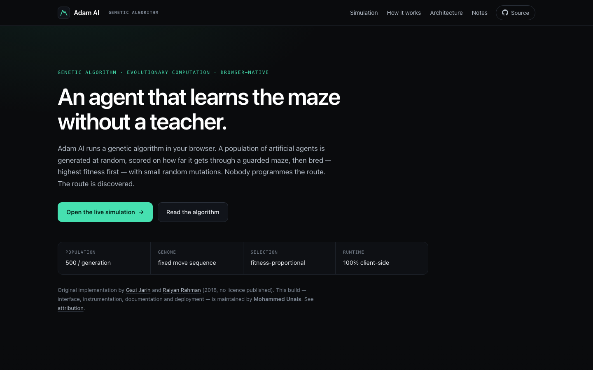
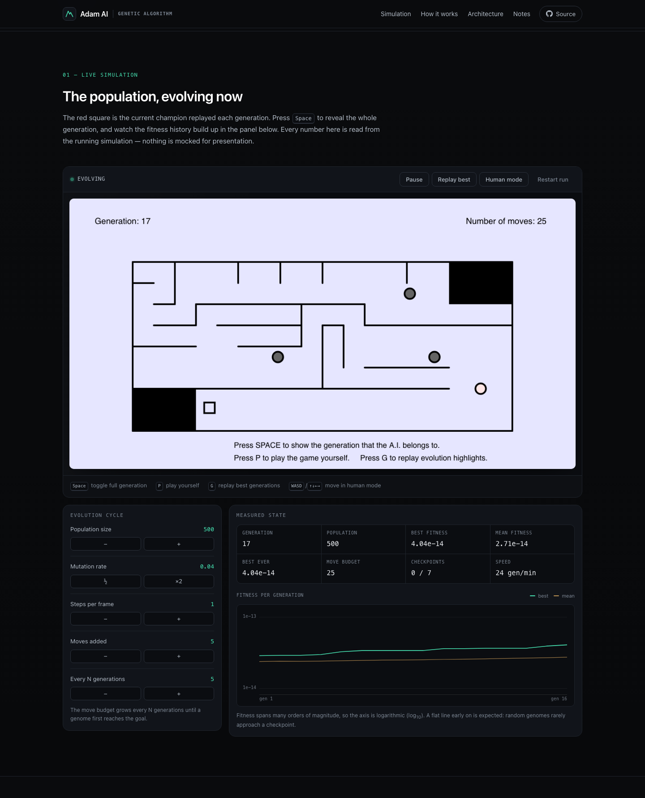
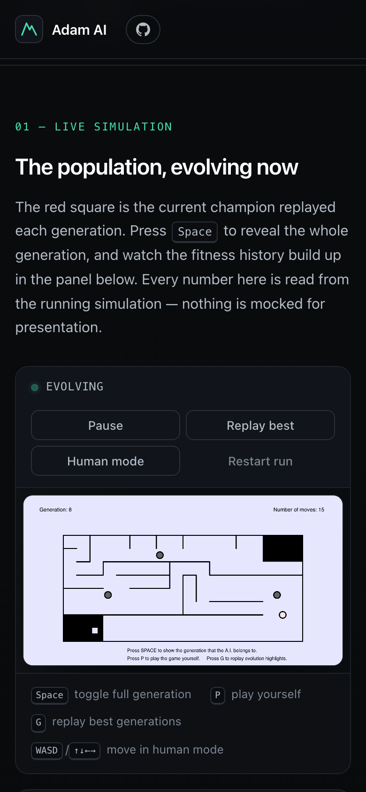
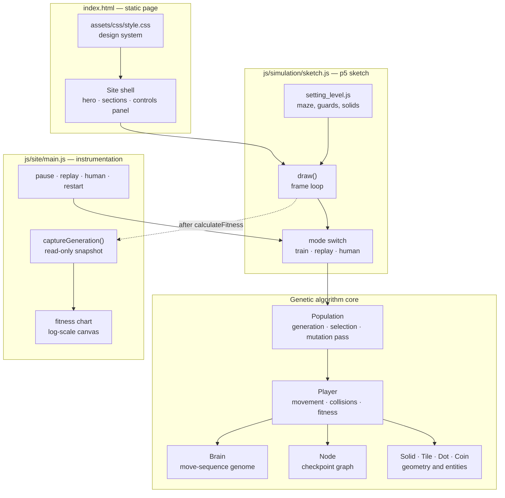
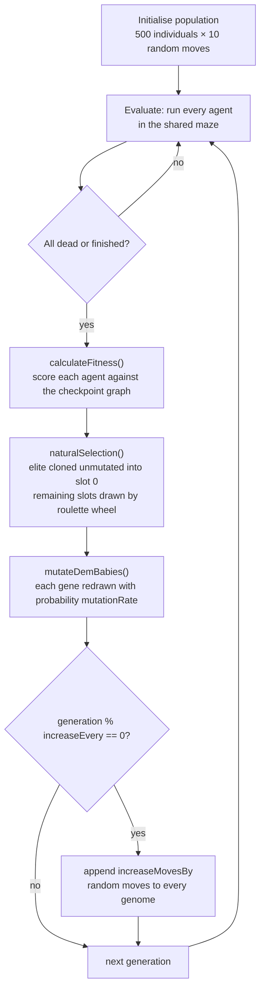
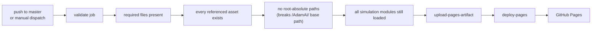

# Adam AI

**Developed and maintained by [Mohammed Unais](https://github.com/PyDeV1OpEr).** An interactive
genetic algorithm that learns to solve a guarded maze — in the browser, with no neural network, no
training data and no server.

Adam AI is an independent redevelopment of an earlier evolutionary simulation. It evolves a
population of agents through fitness-proportional selection, elitism and mutation. Each agent
carries a genome that is literally a sequence of moves; the ones that travel further earn more
offspring, and small random perturbations accumulate into a route through a maze patrolled by
guards. Open the site, and you are watching natural selection run at 60 frames per second against a
real objective.

[](https://pydev1oper.github.io/AdamAI/)

**Live site:** https://pydev1oper.github.io/AdamAI/ · **Repository:**
https://github.com/PyDeV1OpEr/AdamAI

> **Deployed and verified.** GitHub Pages serves the `master` branch of this repository through
> `.github/workflows/deploy.yml`. Deployed 12 November 2026 and redeployed 15 November 2026 after the
> identity and documentation pass; checked on the live URL each time: 500 agents evolving, ~60 fps
> measured, zero console errors, zero failed requests, responsive at both 390 px and 1440 px.

---

## Table of contents

1. [Live demo](#live-demo)
2. [Screenshots](#screenshots)
3. [What this project is](#what-this-project-is)
4. [Key features](#key-features)
5. [Quick start](#quick-start)
6. [Technical architecture](#technical-architecture)
7. [The algorithm, accurately described](#the-algorithm-accurately-described)
8. [Evolutionary learning lifecycle](#evolutionary-learning-lifecycle)
9. [Fitness evaluation methodology](#fitness-evaluation-methodology)
10. [Selection, elitism and mutation](#selection-elitism-and-mutation)
11. [Simulation controls](#simulation-controls)
12. [Configuration and parameters](#configuration-and-parameters)
13. [Project structure](#project-structure)
14. [Technology stack](#technology-stack)
15. [Testing and verification](#testing-and-verification)
16. [Example execution](#example-execution)
17. [Expected behaviour](#expected-behaviour)
18. [Known limitations](#known-limitations)
19. [Deployment](#deployment)
20. [Roadmap](#roadmap)
21. [What I learned building this](#what-i-learned-building-this)
22. [Credits and acknowledgements](#credits-and-acknowledgements)
23. [Licence](#licence)
24. [Maintainer](#maintainer)

---

## Live demo

| | |
|---|---|
| Website | https://pydev1oper.github.io/AdamAI/ |
| Repository | https://github.com/PyDeV1OpEr/AdamAI |
| Original project (forked from) | https://github.com/gazijarin/AdamAI |
| Hosting | GitHub Pages (static, no backend) |
| Browser requirements | Any current Chrome, Firefox, Safari or Edge; JavaScript enabled; no WebGL needed |

Nothing is installed to view it: the simulation is plain JavaScript and canvas 2D, and p5.js is
committed to the repository rather than loaded from a CDN.

---

## Screenshots

Captured from the running build, not mocked up.

**Landing page**



**Live simulation with instrumented analytics**



**Mobile layout (390 × 844)**



---

## What this project is

Adam AI is an independent redevelopment and maintained implementation by Mohammed Unais. It takes
an existing genetic-algorithm simulation as its foundation and rebuilds everything around it — the
interface, the live instrumentation, the documentation and the deployment pipeline — while leaving
the evolutionary operators intact.

A genetic algorithm (GA) is a search procedure inspired by selection in biology. You represent
candidate solutions as strings, score them against an objective, then breed the high scorers with
random variation, generation after generation. It needs no gradients and no labelled examples. It
is the right tool when the objective is easy to *evaluate* but hard to *differentiate* — here, "how
far through the maze did this sequence of moves get you?"

Adam AI puts that loop in a browser and makes every stage visible: the agents, the generation
counter, the fitness distribution, the move budget growing over time. You can tune the population
size and mutation rate mid-run and watch convergence change shape.

**What it is:** an evolutionary/randomised search over fixed-length action sequences, applied to a
single hand-authored maze level.

**What it is not:** deep learning, reinforcement learning, a neural network, or a general maze
solver. There is no policy network, no reward shaping beyond the fitness function below, and no
ability to generalise to a maze it has not seen. The [algorithm section](#the-algorithm-accurately-described)
is precise about this because vague "AI" claims are how these projects get oversold.

---

## Key features

- **Real genetic algorithm in the browser** — population initialisation, fitness evaluation,
  fitness-proportional selection, elitism, per-gene mutation, and generation advancement, all
  inspectable in ~1,400 lines of JavaScript.
- **Incremental move budget** — every *N* generations the genomes grow by *M* moves, so early
  generations solve short prefixes and later ones extend the route. This is what turns a
  needle-in-a-haystack search into a tractable one.
- **Live instrumentation** — generation, population, best/mean fitness, best-ever fitness, move
  budget, checkpoints collected and generations-per-minute, plus a log-scale fitness chart drawn
  from measured data.
- **Human-interactive mode** — press `P` and drive a real agent yourself with `WASD`/arrows. The
  same three guards patrol the same maze, so the level is the one the algorithm had to solve.
- **Generation replay** — press `G` to re-watch the best individual of each generation in sequence.
- **Runtime parameter control** — population size, mutation rate, simulation speed and move-budget
  growth are adjustable without a reload.
- **No build step, no dependencies to install, no external requests** at runtime.
- **Automated deployment** — GitHub Actions validates the tree and publishes to Pages; a failed
  validation blocks the deploy.

---

## Quick start

There is nothing to install. Either:

**Open the file directly**

```bash
git clone https://github.com/PyDeV1OpEr/AdamAI.git
cd AdamAI
open index.html          # macOS; use `xdg-open` on Linux, `start` on Windows
```

**Or serve it (recommended, matches production)**

```bash
cd AdamAI
python3 -m http.server 8000
# then open http://localhost:8000/
```

Any static file server works (`npx serve`, `php -S localhost:8000`, nginx). Serving locally is
recommended because it matches how GitHub Pages delivers the files.

---

## Technical architecture



The instrumentation is deliberately one-directional: it *reads* the population after each
evaluation and never writes back into selection, mutation or the fitness function. The only state
it may change are the explicit user actions (pause flag, whole-run restart).

---

## The algorithm, accurately described

### Representation

Each individual is a `Player`. Its genome is a `Brain`:

```js
class Brain {
  constructor(size) {
    this.directions = [];   // one entry per move
    this.step = 0;
    this.randomize(size);   // numberOfSteps = 10 to start
  }
}
```

A gene is a unit vector drawn from **nine** possibilities: the eight compass directions plus
`(0,0)`, i.e. "stay still for this move". There are no weights, no activation functions and no
inputs — the genome is an open-loop plan, not a policy.

### Execution

A `Player` consumes one gene per move, and holds that direction for **six frames** at
`tileSize / 15 ≈ 3.33 px` per frame, i.e. ≈ 20 px per move on a 50 px tile grid. When the genome
runs out of genes, the individual dies. Movement is resolved against every `Solid` on the x and y
axes separately, which is what lets agents slide along walls rather than sticking to them.

### Population dynamics

`Population` owns the array of players and the generation counter. Each frame it calls `update()`
on every living player; when *all* players are dead or finished, the generation ends and the
following sequence runs once:

```
calculateFitness()  →  naturalSelection()  →  mutateDemBabies()  →  maybe increaseMoves()
```

### The genetic operators that are actually present

| Operator | Present? | Where |
|---|---|---|
| Random initialisation | Yes | `Brain.randomize` |
| Fitness-proportional (roulette) selection | Yes | `Population.selectParent` |
| Elitism (best individual carried over unmutated) | Yes, one slot | `Population.naturalSelection`, slot `0` |
| Mutation (per-gene replacement) | Yes | `Brain.mutate` |
| Crossover / recombination | **No** | not implemented anywhere |
| Mutation-rate adaptation | Partly | 5× mutation on genes near a guard-related death |
| Fitness sharing / diversity preservation | **No** | — |
| Speciation | **No** | — |

Reproduction is asexual. One parent is chosen, cloned, then mutated. This is a legitimate
evolutionary strategy (it resembles a `(1, λ)` strategy with elitism), but it is **not** a
canonical "crossover + mutation" GA, and this README does not claim that it is.

---

## Evolutionary learning lifecycle



The feedback loop is entirely through the genome: nothing about the maze is stored, learned or
generalised. Progress is retained because a longer genome that has already solved part of the maze
tends to score higher than a shorter one that has not, so the genes that produced that progress
survive mutation pressure.

---

## Fitness evaluation methodology

Fitness is computed once per individual, when the generation ends (`Player.calculateFitness`).

**If the agent reached the goal** (all seven checkpoints collected, then contact with the goal
area):

```
fitness = 1/16 + 10000 / steps²
```

Fast solves score higher, and the flat `1/16` term ensures a goal-reaching individual always
outranks any non-goal-reaching one.

**Otherwise**, the agent is scored by an estimate of the path it still had left:

```
estimatedDistance = distance(agent → next unreached checkpoint)
                  + precomputed chain distance from that checkpoint to the goal
fitness = 1 / estimatedDistance²
```

The chain distances are precomputed once per player (`Node.setDistanceToFinish`) by walking
backwards from the goal through the seven checkpoints, so the estimate accounts for the whole
remaining route rather than just the straight line to the goal.

**Then both branches are squared**, and:

- if the agent collected at least one checkpoint → `fitness *= 1.2`
- if the agent died to a guard → `estimatedDistance *= 0.9`

That last line is worth flagging. Because fitness is `1/d²`, multiplying the distance by `0.9`
*shrinks* it and therefore **raises** the score. The intent was evidently a penalty; the effect is a
mild reward for dying to a guard close to the next checkpoint. It is preserved here rather than
silently "fixed", because changing the fitness function changes the algorithm and would invalidate
comparisons with the original project. See [Known limitations](#known-limitations).

### Why the fitness values look tiny

Distances are measured in pixels. A mid-maze distance of ~500 px gives `1/250000`, and squaring
that gives `4 × 10⁻¹¹`-scale numbers — which is why the dashboard plots fitness on a **logarithmic**
axis. A flat line at the start is not a bug; random genomes are all roughly equally bad.

---

## Selection, elitism and mutation

**Selection (`selectParent`).** A roulette wheel over the fitness sum:

```js
var rand = random(this.fitnessSum);
var runningSum = 0;
for (var i = 0; i < this.players.length; i++) {
  runningSum += this.players[i].fitness;
  if (runningSum > rand) return this.players[i];
}
```

Each individual's chance of being chosen is proportional to its fitness. Selection is stochastic,
not greedy, which preserves some exploration.

**Elitism.** Slot `0` of the new generation is an unmutated clone of the best individual, and
`mutateDemBabies()` starts at index `1`, so the champion is never damaged by mutation. If the
champion is lost to a bad draw, the population can regress; this one slot is the guarantee that it
does not.

**Mutation (`Brain.mutate`).**

```js
for (var i = 0; i < this.directions.length; i++) {
  var rand = random(1);
  if (died && i > deathStep - 10) rand = random(0.2);   // 5× more likely to mutate
  if (rand < mutationRate) this.directions[i] = this.getRandomDirection();
}
```

Two details matter:

1. Mutation replaces a gene outright with a random direction. There is no blending, no swap, no
   small perturbation.
2. If the parent was killed by a guard, genes in the ten moves *before* the death are mutated with
   probability `mutationRate / 0.2`, i.e. five times more often. That is a targeted local search
   around the failure point, and it is the one piece of adaptive behaviour in the algorithm.

**Elite replay memory.** Whenever a new best-ever fitness appears, a clone is pushed to
`genPlayers`. That is what the `G` replay walks through.

---

## Simulation controls

Everything is live; no reloads.

| Control | Effect | Range |
|---|---|---|
| **Population size** `− / +` | Individuals per generation. Applies from the next generation. | 100 → 10000, step 100 |
| **Mutation rate** `½ / ×2` | Per-gene probability of redraw. | ≈7.8e-05 → 0.64 (halve/double from 0.04) |
| **Steps per frame** `− / +` | Simulation steps per rendered frame (visual speed only). | 1 → 8 |
| **Moves added** `− / +` | How many genes the growth step appends. | 1 → 500 |
| **Every N generations** `− / +` | How often the growth step fires. | 1 → 100 |
| **Pause / Resume** | Freezes agent updates; rendering continues. | — |
| **Replay best** | Replays stored best individuals generation by generation. | — |
| **Human mode** | You drive an agent on the live maze. | — |
| **Restart run** | New population from the current population size; resets analytics. | — |

Keyboard (only when focus is in the page):

| Key | Action |
|---|---|
| `Space` | Toggle between showing only the champion and the whole generation |
| `P` | Enter / leave human mode |
| `G` | Start / stop best-generation replay |
| `WASD` or arrow keys | Move your agent in human mode |

### The maze

- Grid: 22 × 10 tiles at 50 px (`tileSize`), playable interior 18 × 8.
- Start: bottom-left safe area. Goal: top-right black area, reachable only after **seven
  checkpoints**, each marked by a circle that disappears when collected.
- Three patrol guards (`Dot`) oscillate along fixed segments and kill on contact.

---

## Configuration and parameters

Defaults live as globals in `js/simulation/sketch.js` (and are adjusted by the on-page controls at
runtime):

| Global | Default | Meaning |
|---|---|---|
| `populationSize` | `500` | Individuals per generation |
| `mutationRate` | `0.04` | Per-gene mutation probability |
| `evolutionSpeed` | `1` | Simulation steps per rendered frame |
| `numberOfSteps` | `10` | Initial genome length (moves per individual) |
| `increaseMovesBy` | `5` | Genes appended at each growth step |
| `increaseEvery` | `5` | Generations between growth steps |
| `tileSize` | `50` | Pixels per maze tile |
| `xoff`, `yoff` | `50`, `100` | Board origin inside the 1200 × 640 canvas |

Derived constants worth knowing: agent speed is `tileSize / 15 ≈ 3.33 px/frame`; each gene is held
for 6 frames (≈ 20 px); `minStep` pruning compares against `10000` until a solution is found, then
against the best solve so far.

The level itself is defined procedurally in `js/simulation/setting_level.js`: wall flags
(`setLevel1Walls`), goal tiles (`setLevel1Goal`), safe area, wall-edge segments (`setEdges`), guards
(`setDots`) and collision solids (`setSolids`). Editing that file is the supported way to change
the maze.

---

## Project structure

```
AdamAI/
├── .github/
│   └── workflows/
│       └── deploy.yml          # validate + deploy to GitHub Pages
├── .gitignore
├── .nojekyll                   # serve files verbatim (no Jekyll)
├── LICENSE                     # MIT licence, both copyright notices retained
├── NOTICE.md                   # provenance, credits, third-party licences
├── README.md
├── index.html                  # the page: hero, simulation shell, docs, footer
├── assets/
│   └── css/
│       └── style.css           # design system, responsive layout
├── js/
│   ├── simulation/             # the genetic algorithm (inherited, documented in NOTICE)
│   │   ├── Brain.js            # genome: random init, mutation, cloning, growth
│   │   ├── Node.js             # checkpoint graph + distance-to-finish
│   │   ├── Player.js           # movement, collisions, fitness, cloning
│   │   ├── Population.js       # generation loop, selection, mutation pass
│   │   ├── Dot.js              # patrolling guards
│   │   ├── Coin.js             # collectible checkpoints
│   │   ├── Solid.js            # axis-separated wall collision
│   │   ├── Tile.js             # grid cell rendering
│   │   ├── setting_level.js    # maze geometry, walls, goal, guards
│   │   └── sketch.js           # p5 lifecycle, modes, control panel, host loop
│   └── site/
│       └── main.js             # instrumentation, chart, page controls
├── libraries/                  # vendored p5.js 0.5.8 (LGPL-2.1) — see libraries/README.md
│   ├── p5.js
│   ├── p5.dom.js
│   ├── p5.sound.js             # present for fidelity to the original; not loaded
│   └── README.md
└── docs/
    └── screenshots/            # captured from the running build
```

About 1,400 lines of simulation code (563 of them the p5 sketch and its controls), ~465 lines of
instrumentation and ~1,320 lines of CSS; total repository ~2 MB, of which 1.3 MB is the vendored
p5.js bundle.

---

## Technology stack

| Layer | Choice | Why |
|---|---|---|
| Language | ES5/ES6 JavaScript | Runs as-is in the browser; no transpiler in the dependency chain |
| Rendering | p5.js 0.5.8 (canvas 2D) | The original was written against it; vendored for offline reliability |
| Styling | Hand-written CSS (custom properties, grid, flex) | No framework needed for one page; nothing to purge or compile |
| Charts | Canvas 2D, ~120 lines in `js/site/main.js` | Avoids adding a charting dependency for one line chart |
| Build | None | What you see is what is served |
| CI/CD | GitHub Actions + GitHub Pages | Official `configure-pages` / `upload-pages-artifact` / `deploy-pages` |
| Dependencies | 0 runtime packages | p5.js is committed; no npm install required |

Rubric for the choices: the deliverable is a public demo that must still work in five years. A
static tree with a vendored renderer and no lockfile is the smallest thing that satisfies that.

---

## Testing and verification

All of the following was executed against this build. Anything not executed is listed as not
performed — there are no invented results.

### Passed

| Check | Method | Result |
|---|---|---|
| Page loads with no console errors | Headless Chrome, CDP console + exception capture | 0 errors, 0 failed requests |
| Simulation runs | Same, 500 individuals | generation advancing, 60 fps, `frameRate()` measured |
| Generation advancement | Drove `draw()` directly, 500 individuals | reached generation 17 in ~32 s wall clock |
| Move-budget growth | Same run | `10 → 25` moves at generation 17 (grows every 5 generations by 5) |
| Fitness improvement | 60-individual soak run, 68 generations | best-ever rose `0 → 7.92e-14`; see [example execution](#example-execution) |
| Fitness evaluation | Read `Population.bestFitness` and per-player `fitness` after `calculateFitness()` | values consistent with the formula above |
| Selection | Ran generations and observed `genPlayers` growth (new bests recorded) | 4 recorded bests in 10 generations of a small run |
| Mutation | Code path exercised every generation via `mutateDemBabies()` | no exceptions; genomes diverge between generations |
| Pause | Clicked **Pause**, compared `brain.step` before/after 30 frames | frozen; status pill switches to `Paused` |
| Resume | Clicked again | stepping resumes |
| Restart | Clicked **Restart run** | generation back to 1, budget back to 10 |
| Replay mode | Clicked **Replay best**, drew 60 frames, toggled off | enters and exits cleanly, no errors |
| Human mode | Entered mode, injected `left` input, drew 60 frames | agent moved left from spawn; exits cleanly |
| Collision detection | Observed agents blocked at walls and killed by guards across runs | consistent with `Solid.restrictMovement` |
| Analytics accuracy | Compared dashboard values against live globals | dashboard reads the same objects, no divergence |
| Responsive layout (desktop) | 1440 × 900 and 1440 × 1560 viewports | no horizontal overflow, canvas scales to 1130 px |
| Responsive layout (mobile) | 390 × 844, 2× DPR | no overflow (`scrollWidth == innerWidth`), toolbar reflows to 2×2 |
| Section layout | Computed grid columns at 1440 px and 390 px | evolution pipeline 6 → 2 columns, highlights 3 → 1, no overflow |
| Navigation and fragments | Clicked each nav link; resolved every `href="#…"` against element ids | all six fragments resolve, no dead anchors |
| Toggle state exposure | Read `aria-pressed` on **Replay best** / **Human mode** while active and after exit | `true` while active, `false` on exit |
| GitHub Pages base path | Served the tree from `/AdamAI/` locally and loaded it | 200s, stylesheet applied, simulation ran, no 404s |
| **Live deployment** | Loaded https://pydev1oper.github.io/AdamAI/ in Chrome over CDP after the redeploy | 18/18 requests 200, simulation advancing, 2.08 ms/frame, 0 console errors |
| Repository metadata | `gh api repos/PyDeV1OpEr/AdamAI` | genuine fork of `gazijarin/AdamAI`, default branch `master`, Pages `build_type: workflow`, homepage and description set, licence detected as MIT |
| Workflow validation logic | Ran the workflow's shell gates locally | all four gates pass on this tree |

### Not performed

- **No automated unit-test suite is committed.** The algorithm was verified by driving the real
  page in a real browser (above), not by a headless test harness. Adding one is on the
  [roadmap](#roadmap); it is not claimed to exist.
- **No cross-browser matrix.** Verified in Chromium on macOS only. Firefox and Safari are expected
  to work (no Chromium-specific APIs) but were not executed.
- **No long-run convergence test to the final goal.** Short verification runs did not reach the
  first checkpoint; the upstream project reports ~50 generations to checkpoint one at 500
  individuals and speed 6, which was not independently reproduced here.
- **No mobile touch testing of the canvas itself.** The layout was verified at phone dimensions;
  the simulation is keyboard-driven, so touch only affects scrolling and buttons.
- **No load/latency profiling beyond frame rate.** `frameRate()` observed at 60–64 fps with 500
  individuals; a single synthetic timing of the draw loop was ~2.2 ms per frame.

---

## Example execution

A verification run with a deliberately small population (60 individuals, headless Chrome, driven
frame by frame so the numbers are reproducible rather than dependent on refresh rate):

| Generation | Move budget | Best-ever fitness | Checkpoints collected |
|---:|---:|---:|---:|
| 10 | 20 | 3.05e-14 | 0 |
| 20 | 30 | 3.73e-14 | 0 |
| 30 | 40 | 4.68e-14 | 0 |
| 40 | 50 | 6.08e-14 | 0 |
| 50 | 60 | 6.82e-14 | 0 |
| 60 | 70 | 7.17e-14 | 0 |
| 68 | 75 | 7.92e-14 | 0 |

What this shows: monotone improvement under selection, and a move budget growing exactly as
configured. What it also shows is that 60 individuals is not enough to reach the first checkpoint
within 68 generations — the search space of 22-direction-prefix sequences is much larger than that.
Use the default 500, and expect to wait.

This is a verification trace, not a benchmark: it ran on one machine, and wall-clock timings depend
on hardware and browser.

---

## Expected behaviour

- **First seconds:** all agents are random. Most die against a wall or exhaust their ten moves within
  a second. The champion replays its (bad) run each generation, which is why the red square moves
  erratically at first.
- **First tens of generations:** the champion starts travelling further left-to-right as the
  algorithm finds longer viable prefixes. Fitness climbs on a log scale.
- **Around generation 50 (defaults):** the first checkpoint is typically collected; the champion's
  path visibly reaches the first circle. The upstream project reports this timing at 500
  individuals and speed 6; later checkpoints take substantially longer.
- **Convergence:** because there is one elite slot and no diversity pressure, the population
  visually collapses onto similar paths. If it stalls, lift the mutation rate or change the
  population size to perturb the search.
- **Long runs:** the move budget keeps growing until a solution is found (`solutionFound`), after
  which growth stops. The dashboard's "Goal reached in N moves" banner appears when a run solves the
  maze.

---

## Known limitations

1. **No generalisation.** One hand-authored level. The genome cannot transfer to a new maze; it
   would have to be re-evolved.
2. **Open-loop control.** Genes are a plan, not a policy. Agents cannot react to a guard's position,
   only memorise timings — so a guard's phase change invalidates learned behaviour.
3. **Premature convergence.** One elite slot, no fitness sharing, no crossover. Diversity collapses.
4. **Fitness inversion on guard death.** `estimatedDistance *= 0.9` rewards rather than penalises
   guard deaths (see [fitness methodology](#fitness-evaluation-methodology)). Preserved for
   comparability with upstream, documented rather than hidden.
5. **Squared distance scaling** makes early fitness values extremely small, compressing the useful
   signal into a narrow band. The dashboard compensates with a log axis; the algorithm does not.
6. **Population changes are not retroactive.** Raising the population applies at the next
   generation.
7. **No persistence.** Refreshing loses the run; there is no export, no seed control, no replay file.
8. **Single-threaded rendering.** The population cap is 10,000; at that size expect a much
   lower frame rate than the 60 fps observed with 500.
9. **The maze geometry is data, not a generator**, so "level 2" is an editing task in
   `setting_level.js`, not a feature.

---

## Deployment

Adam AI is a static site, so deployment is "publish these files". The workflow does exactly that,
and refuses to publish if the tree is inconsistent.



### Repository setup (already done)

Pages is configured for this repository with `build_type: workflow` — **Settings → Pages → Build
and deployment → Source: GitHub Actions**. That is a one-time setting; after it, any push to
`master` republishes automatically, and the workflow can also be run manually from the Actions tab
(`workflow_dispatch`).

If you fork this project yourself, you must set that Pages source in your own fork before the
deploy step will succeed — the first push otherwise fails at *Configure Pages* with
`Get Pages site failed`.

The site is served from `https://pydev1oper.github.io/AdamAI/`. All asset paths in `index.html`
are relative, which is why the `/AdamAI/` sub-path works without a build-time base-path setting — the
workflow enforces that invariant on every run.

### Repository metadata (set)

| Field | Value |
|---|---|
| Description | *An interactive genetic algorithm simulation exploring evolutionary computation through real-time AI maze navigation.* |
| Website | https://pydev1oper.github.io/AdamAI/ |
| Topics | `genetic-algorithm`, `evolutionary-computation`, `artificial-intelligence`, `machine-learning`, `javascript`, `maze-solving`, `computational-intelligence`, `evolutionary-algorithms`, `p5js`, `github-pages` |

---

## Roadmap

Ordered by ratio of learning value to risk of destabilising the existing simulation.

1. **Headless test harness.** Run the simulation modules under Node with a p5 shim and assert:
   fitness monotonicity across generations, elite preservation, genome growth at the right
   generations, elitism slot immutability. This turns the manual verification above into CI.
2. **Experiment runner.** Multiple seeded runs with JSON export: generations-to-first-checkpoint,
   success rate, convergence curves. Deterministic seeding is the prerequisite, and is currently
   absent (p5's `random` is unseeded).
3. **Ablation studies.** Compare population sizes, mutation rates and mutation schedules on the same
   seeded runs; publish the table. This is the cheapest genuinely scientific result available here.
4. **Crossover as an opt-in operator.** Implement two-parent recombination and measure it against the
   current asexual baseline. Doing this *with* an ablation is what makes it a real contribution
   rather than a feature.
5. **Policy representation.** Replace the fixed move sequence with a small network or a
   state→direction table, then compare sample efficiency against the open-loop genome. This is the
   honest bridge from evolutionary computation to reinforcement learning.
6. **Multi-level support.** Move the level definition into data and add a second, unseen maze to
   measure generalisation.

Items 1–3 are engineering and analysis; 4–6 change the algorithm and would need the baseline
preserved for comparison.

---

## What I learned building this

- **Reading an algorithm is not the same as understanding it.** The upstream README describes
  incremental learning and fitness-based selection; the code has no crossover, mutates only by
  redrawing genes, and inverts the guard-death penalty. Documenting this required reading every
  file, not the description.
- **Instrumentation is design work.** Choosing *which* quantity to show (best vs mean fitness, move
  budget, generations per minute) forced a precise definition of each, and exposed that fitness
  spans ten orders of magnitude — hence the log axis.
- **Preserving a working implementation beats rewriting it.** The temptation was to reimplement the
  GA cleanly. Keeping the original operators meant the demo is the original algorithm, and every
  claim in this README is checkable against inherited code.
- **Licensing is part of engineering.** Redistributing inherited code needs an actual grant, not an
  assumption. Recording that permission, retaining the original copyright notice and documenting
  provenance is part of shipping responsibly.
- **Static hosting shapes architecture.** A base-path-safe, dependency-free, build-free tree is
  what makes a Pages deployment reliable — and the workflow now enforces those invariants.

---

## Credits and acknowledgements

**Original implementation.** The simulation — the genetic algorithm, the maze, the p5 sketch — was
created by [Gazi Jarin](https://github.com/gazijarin) with
[Raiyan Rahman](https://github.com/RaiyanRahman) and published as
[gazijarin/AdamAI](https://github.com/gazijarin/AdamAI) in December 2018. It is reused and developed
further with the authors' permission, and remains their work; this project makes no claim to have
independently developed it.

**Algorithmic lineage.** The structure of the genetic algorithm follows
[Code Bullet](https://github.com/Code-Bullet)'s work, as credited in the upstream README.

**Redevelopment (Mohammed Unais).** The interface and design system, the live instrumentation and
fitness chart, the control bindings and mode helpers, the defect fixes and accessibility pass, the
documentation, and the CI/deployment pipeline. Details in [NOTICE.md](NOTICE.md).

**Libraries.** [p5.js](https://p5js.org) 0.5.8 and p5.dom 0.3.2, © p5.js contributors, LGPL-2.1.

---

## Licence

Adam AI is released under the **MIT License**: © 2018 Gazi Jarin and Raiyan Rahman, © 2026 Mohammed
Unais. The original implementation is reused and redistributed with its authors' permission, and
their copyright notice is retained in [LICENSE](LICENSE).

- **Inherited simulation** (`js/simulation/**`) — the genetic algorithm and the maze, originally by
  Gazi Jarin and Raiyan Rahman, reused with permission under the MIT License.
- **This rebuild** — interface, design system, instrumentation, documentation and deployment, by
  Mohammed Unais, under the same licence.
- **Third-party** (`libraries/**`) — p5.js 0.5.8 and addons, **LGPL-2.1**; see
  [libraries/README.md](libraries/README.md).

File-by-file provenance and the record of modifications to inherited files are in
[NOTICE.md](NOTICE.md).

---

## Maintainer

**Mohammed Unais** — [@PyDeV1OpEr](https://github.com/PyDeV1OpEr)

Issues and pull requests are welcome, particularly for the [roadmap](#roadmap) items. If you are
reviewing this project as a hiring manager: the interesting discussion is in the fitness function,
the selection pressure, and why an open-loop genome cannot generalise — all of which are in the code
above and none of which are hidden behind a framework.
